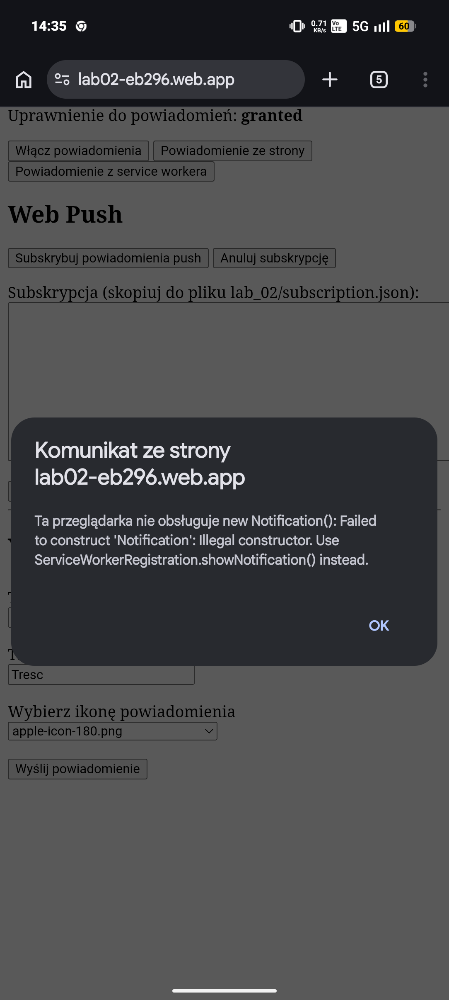
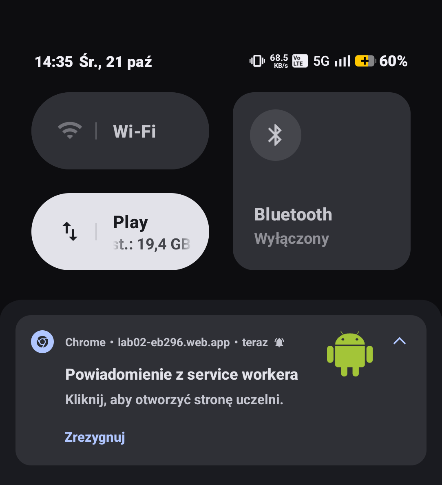
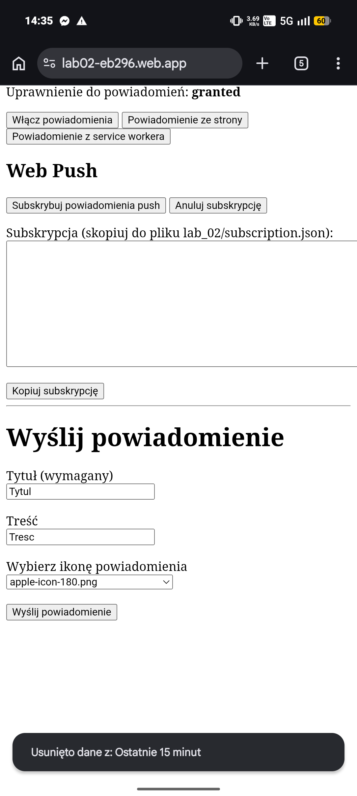
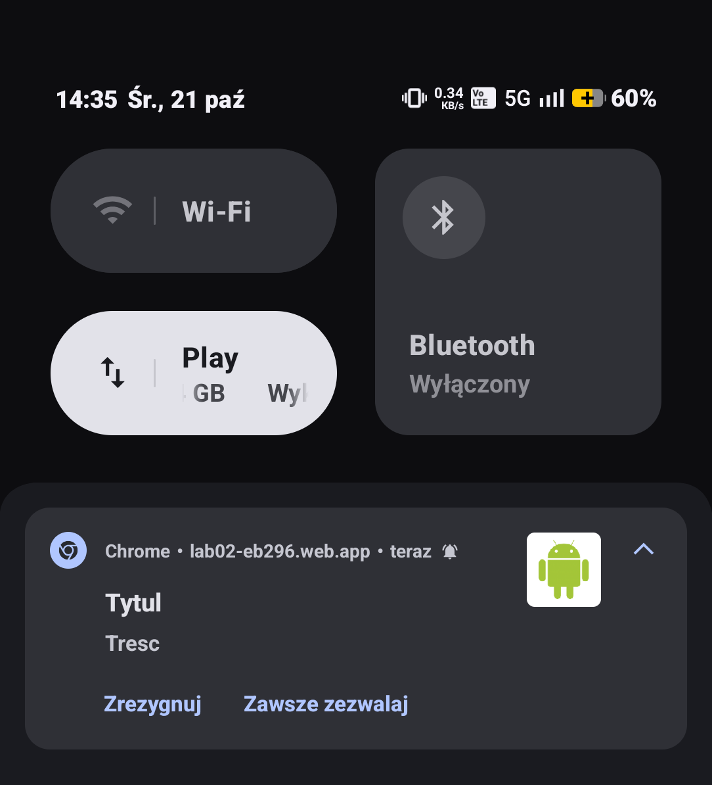

# Lab 02 – [Powiadomienia i Web Push]
## Co zostało zrealizowane
Została wykonana prosta strona z tesktem, przyciskami do nadania uprawnień do powiadomień, wysyłania powiadomień poprzez Notification API, Web Push, a także stan nadanych uprawnień. Dodatkowo zadanie wymagało utworzenie formularza do wysyłania powiadomień z wybranym tytułem, opisem i obrazkiem.
## Uruchomienie
Strona jest aktualnie hostowana pod adresem https://lab02-eb296.web.app
## Obrazki
Brak możliwości powiadomień Notification Api na androidzie

Powiadomienie z Service Workera

Formularz i powiadomienie z formularza

