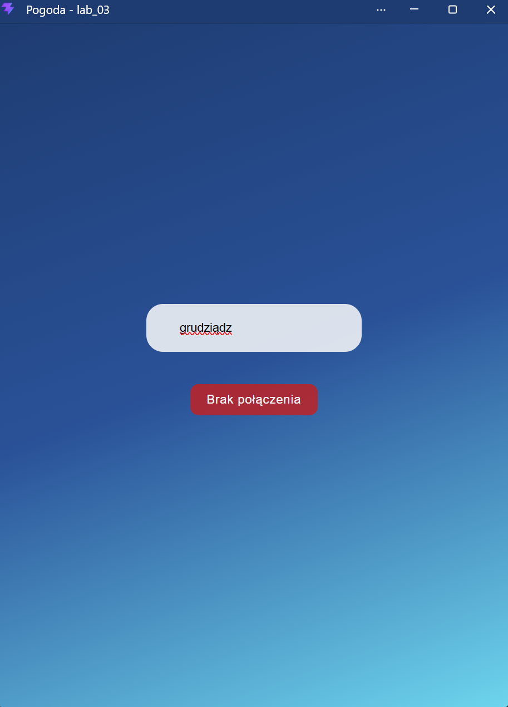
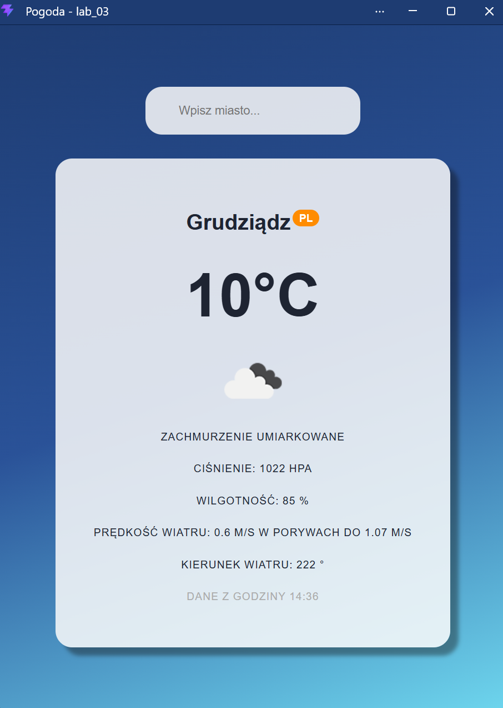
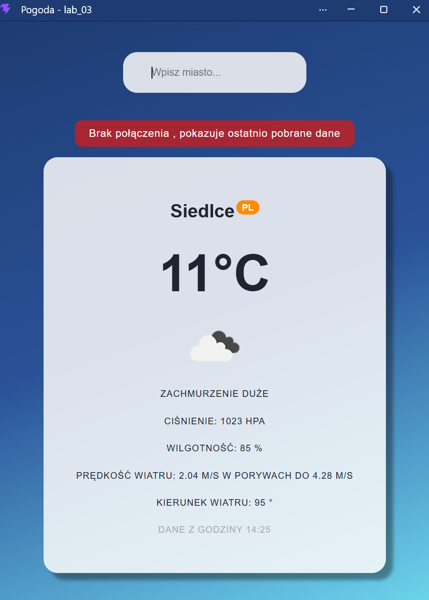

# Lab 03 – [Komunikacja sieciowa w PWA]
## Co zostało zrealizowane
Została wykonana aplikacja pogodowa PWA komunikująca się z API OpenWeatherApp, obsługująca cache'owanie oraz status offline. 
## Uruchomienie
Po pobraniu katalogu z repozytorium GitHub należy umieścić go w odpowiednim folderze, który nie będzie blokował plików w node_modules, może być to na przykład C:\dev\lab_03. Brakuje odpowiednich modułów npm, które trzeba pobrać. Pierwszym krokiem jest uruchomienie wiersza poleceń w folderze lab_03, a w nim komendy:
```bash 
npm install
``` 
Po pobraniu odpowiednich modułów należy zbudować aplikację poleceniem:
```bash 
npm run build
``` 
Utworzy to gotową do wdrożenia aplikację, którą następnie uruchomiamy poleceniem: 
```bash 
npm run preview
``` 
Aplikacja zostanie udostępniona pod wskazanym w wierszu poleceń adresie (http://localhost:4173).
## Obrazki
Brak połączenia internetowego - niemożliwe pobranie danych

Działające połączenie z API i wyświetlanie danych

Działanie w trybie offline na podstawie cache'owanych danych.
